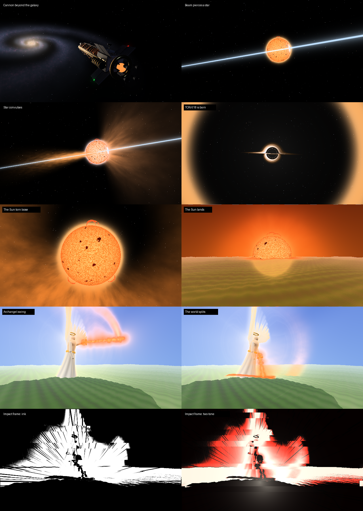

# TON 618 (Forge 1.20.1)

An intergalactic railgun with three strikes: TON 618 (born from a star the beam runs through), the Sun
itself, and an Archangel with a sword of fire. Nothing is drawn with Minecraft blocks or particles: space,
the cannon, the Earth, the Sun and the Archangel are raymarched in their own shaders, the black hole is
integrated per pixel through its own gravity, and every frame goes through an HDR post pipeline with
bloom, god rays and anime impact frames.

*(Rendered offline with the mod's actual shaders: `tools/render_space.py`, `tools/render_world.py`,
`tools/render_impact.py`, `tools/render_test.py`.)*

## How to use
1. Get the **SS-618 Remote** (Tools & Utilities or Combat creative tab, or `/give @s ton618:remote`).
2. **Sneak + use** (with nothing locked) to choose the strike: **TON 618**, **The Sun** or **Archangel**.
3. Look at the ground and **use** it: the target is locked (brackets, range readout).
4. **Use again within 5 s** to fire. **Sneak + use** cancels a lock.

Everyone within 512 blocks sees the cutscene. Hold **Shift** for a second to skip it.

### TON 618 (27 s)
The cannon wakes far outside the Milky Way, charges, and fires. We ride the beam across the galaxy. It runs
a star through: the star convulses, implodes in a white flash, and a black hole spins up its accretion disk
from the star's remains. A second pulse drives it out. It falls across the galaxy, through Earth's sky, and
onto the target. Then it eats a sphere of the world (default radius 160): blocks are torn loose and
spiral into it, and mobs and players are dragged in slowly, harder the closer they get.

### The Sun (23 s)
The cannon seizes the Sun and tears it out of its place. It swells over the Earth until the day side cooks;
from the ground the sky turns to fire as it comes down. It burns out a crater with a molten floor, scorches
the land around it to blackstone and magma, and blows everything nearby away in flames.

### Archangel (17 s)
The clouds part over the target and a pillar of light comes down. The Archangel descends it, settles,
raises a sword of fire (keyframed with anticipation, overshoot, a coil before the blow and follow-through),
and brings it down. A rift opens through the world along the cut, from the surface into the void.

### Impact frames
Every big beat (the shot, the star pierced, the collapse, the Sun torn loose, landings, the blow) cuts to a
stutter of stark frames: ink, negative, two-tone, halftone and white-out, with speed lines converging on
the hit, the image torn into slices and a punch-in zoom, before the flash and the shockwave.

### Test commands (op)
`/ton618 strike [hole|sun|angel]` (full sequence at the block you look at), `/ton618 drop`,
`/ton618 preview [distance] [size]`, `/ton618 clear`.

## Config
**Client** `config/ton618-client.toml`: `quality` LOW/MEDIUM/HIGH/ULTRA, `bloom`, `aberration`, `filmGrain`,
`cameraShake`, `flash`.

**Server** `<world>/serverconfig/ton618-server.toml`: `holeSize`, `destructionRadius`, `blocksPerTick`
(performance budget), `consumeSeconds`, `lingerSeconds`, `destroyBlocks`, `pullEntities`, `lockRange`,
`cooldownSeconds`, `cutsceneRadius`, `debrisPerTick`; `sunRadius`, `scorchRadius`; `angelHeight`,
`riftLength`, `riftWidth`.

## Build
Push to GitHub (Actions builds the jar) or run `gradlew build`. No other mods required.

## Notes
- The remote's range is capped by the server view distance so the cutscene's world shots are in loaded terrain.
- Needs OpenGL 3.2. If a shader fails to compile the effect is disabled with a chat message (details in `latest.log`).
- Shaderpacks (Oculus/Iris) may conflict with the post pipeline.
- Edit shaders live: change files in `assets/ton618/shaders/fx/` and press F3+T.
- Destruction cost scales with radius³: radius 160 ≈ a minute at the default budget; 300+ takes many minutes.

## Credits
Code, shaders and sounds are original to this project. Earth imagery: NASA (public domain), see
`assets/ton618/textures/space/CREDITS.txt`.
