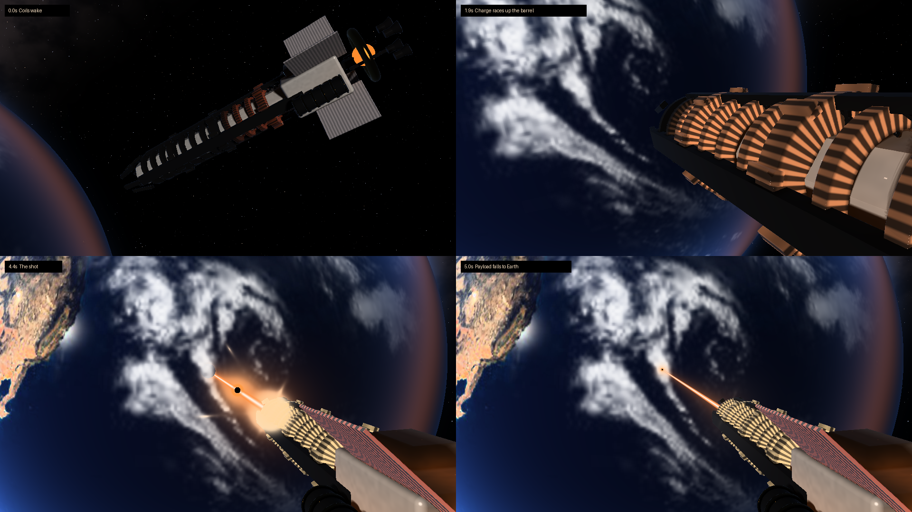
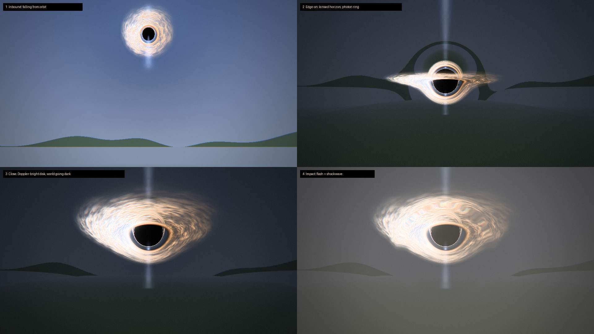

# TON 618 (Forge 1.20.1)

An orbital railgun that drops TON 618, one of the most massive black holes known, onto your world.
Nothing is drawn with Minecraft blocks or particles: the cannon and the Earth are raymarched in their own
shader, the black hole is integrated per pixel through its own gravity over the real world, and the whole
frame goes through an HDR post pipeline.

*(Rendered offline with the mod's actual shaders: `tools/render_orbit.py`, `tools/render_test.py`.)*

## How to use
1. Get the **SS-618 Remote** (Tools & Utilities or Combat creative tab, or `/give @s ton618:remote`).
2. Look at the ground and **use** it: the target is locked (brackets, range readout).
3. **Use again within 5 s** to fire. **Sneak + use** cancels.

### What happens (19 s cutscene for everyone within 512 blocks)
| Time | Shot |
|---|---|
| 0.0 s | Orbit: the railgun above the Earth; its coils wake, breech to muzzle |
| 1.9 s | Tracking along the barrel as the charge races up it; countdown |
| 3.5 s | Down the line of fire: the shot, the beam, the projectile falling to Earth |
| 5.5 s | White-out into the world: from near the target, TON 618 enters the sky |
| 9.0 s | Over the shooter's shoulder; the world darkens, the ground shakes |
| 13.1 s | Low and close, lens tightening |
| 15.0 s | Impact: flash, afterimage, shockwave; the camera cranes away as the world is eaten |

Hold **Shift** for a second to skip. After the cutscene the hole stays, consuming a sphere of the world
(default radius 160) shell by shell and dragging in mobs, items and survival players, then collapses.

### Test commands (op)
`/ton618 strike` (full sequence at the block you look at), `/ton618 drop`, `/ton618 preview [distance] [size]`,
`/ton618 clear`.

## Config
**Client** `config/ton618-client.toml`: `quality` LOW/MEDIUM/HIGH/ULTRA, `bloom`, `aberration`, `filmGrain`,
`cameraShake`, `flash`.

**Server** `<world>/serverconfig/ton618-server.toml`: `holeSize`, `destructionRadius`, `blocksPerTick`
(performance budget), `consumeSeconds`, `lingerSeconds`, `destroyBlocks`, `pullEntities`, `lockRange`,
`cooldownSeconds`, `cutsceneRadius`.

## Build
Push to GitHub (Actions builds the jar) or run `gradlew build`. No other mods required.

## Notes
- The remote's range is capped by the server view distance so the cutscene's world shots are in loaded terrain.
- Needs OpenGL 3.2. If a shader fails to compile the effect is disabled with a chat message (details in `latest.log`).
- Shaderpacks (Oculus/Iris) may conflict with the post pipeline.
- Edit shaders live: change files in `assets/ton618/shaders/fx/` and press F3+T.
- Destruction cost scales with radius³: radius 160 ≈ a minute at the default budget; 300+ takes many minutes.

## Credits
Code, shaders and sounds are original to this project. Earth imagery: NASA (public domain), see
`assets/ton618/textures/space/CREDITS.txt`.
